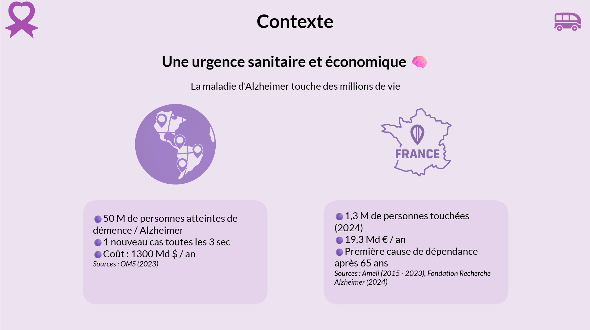
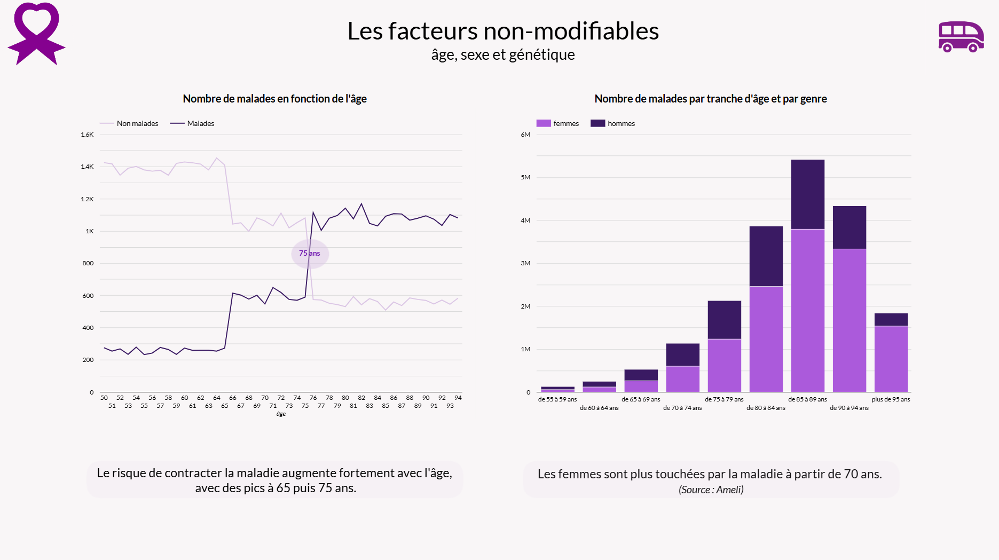
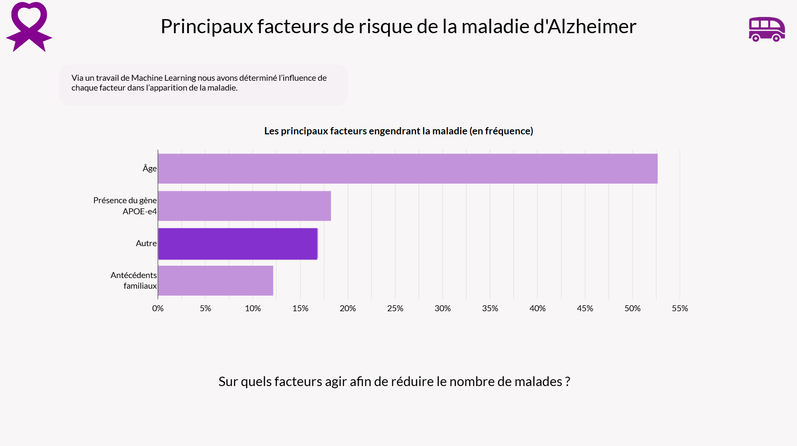
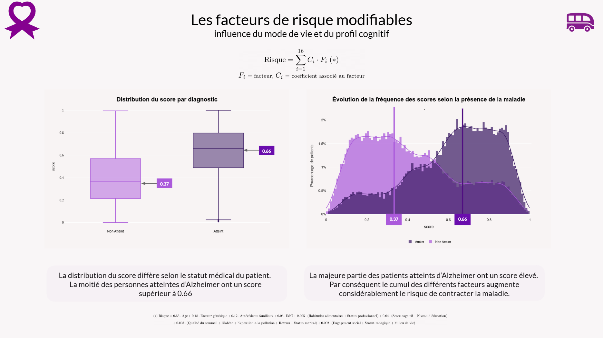
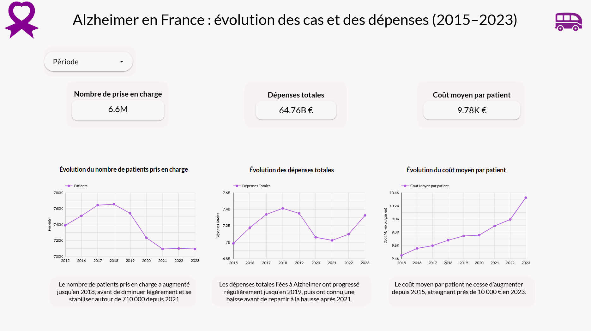
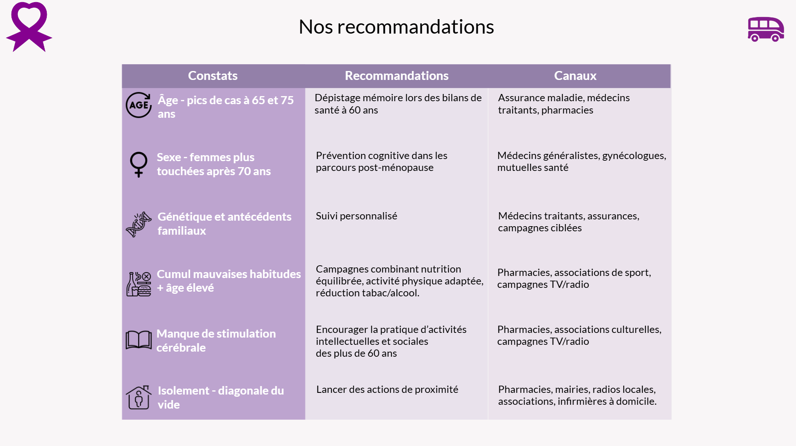

# Facteurs de risque d'Alzheimer : aide à la décision en santé publique

> Identifier les **facteurs de risque** et les **profils à cibler** pour renforcer la prévention de la maladie d'Alzheimer, et mesurer son **impact sanitaire et économique en France**, dans un tableau de bord interactif.

   

**[Voir le tableau de bord interactif](https://datastudio.google.com/reporting/82a08f95-728b-4f78-bd21-4cf885ade742)**

## Le problème

La maladie d'Alzheimer touche environ 1,3 million de personnes en France et coûte près de 19 milliards d'euros par an (Fondation Recherche Alzheimer, 2024). C'est la première cause de dépendance après 65 ans.

**Question posée :** quels sont les facteurs de risque et les profils à cibler, afin de renforcer la prévention et de réduire l'impact sanitaire et économique de la maladie ?

## Résultats clés

| | |
|---|---|
| Sources croisées | Assurance Maladie (Ameli, 2015 à 2023) et deux jeux de données Kaggle |
| Facteur le plus influent | **L'âge**, qui compte pour plus de la moitié dans le modèle, devant le gène APOE-ε4 et les antécédents familiaux |
| Score de risque | Un score combinant 16 facteurs pondérés : **0,66** en médiane chez les malades contre **0,37** chez les autres |
| En France | Environ **710 000 patients** pris en charge chaque année et **64,8 milliards d'euros** de dépenses de 2015 à 2023 |

## Les données

| Source | Contenu | Utilisation |
|---|---|---|
| [Assurance Maladie (Ameli)](https://data.ameli.fr/) | Patients pris en charge et dépenses par pathologie, par âge, sexe et département, de 2015 à 2023 | Poids de la maladie en France et répartition géographique |
| [Alzheimer's Disease Dataset (Kaggle)](https://www.kaggle.com/datasets/rabieelkharoua/alzheimers-disease-dataset) | Données de santé, de mode de vie et cliniques de patients | Facteurs de risque |
| [Alzheimer's Prediction Dataset, Global (Kaggle)](https://www.kaggle.com/datasets/ankushpanday1/alzheimers-prediction-dataset-global) | Plus de 74 000 profils : âge, génétique, antécédents, mode de vie | Facteurs de risque et profils types |

Les jeux de données Kaggle sont en partie **simulés** : ils servent à illustrer la méthode d'analyse des facteurs de risque. Les chiffres sur la France viennent uniquement des données de l'Assurance Maladie.

## Démarche

### 1. Transformation des données avec dbt sur BigQuery

Chargement des trois sources dans **Google BigQuery**, puis transformation avec **dbt** : nettoyage, harmonisation, jointures et construction de tables prêtes pour l'analyse. Des **tests de qualité automatisés** vérifient les données à chaque étape de la transformation.

### 2. Les facteurs de risque non modifiables : âge, sexe, génétique

- Le risque augmente fortement avec l'âge, avec des paliers à 65 puis 75 ans.
- Les femmes sont plus touchées à partir de 70 ans.
- La présence de l'allèle **APOE-ε4** : 61 % de malades parmi les porteurs, contre 37 % chez les non-porteurs.
- Les **antécédents familiaux** : 52 % de malades contre 37 %.

### 3. Le poids de chaque facteur, mesuré par machine learning

Un modèle de machine learning mesure l'influence de chaque facteur dans l'apparition de la maladie. L'âge arrive très largement en tête (53 %), devant le gène APOE-ε4 (18 %) et les antécédents familiaux (12 %).

### 4. Les facteurs de risque modifiables : mode de vie et profil cognitif

- Pris un par un, l'hypertension, le cholestérol, le diabète ou le tabac ne changent presque pas la proportion de malades.
- Parmi les facteurs de mode de vie, l'**IMC**, les **résultats aux tests cognitifs** et le **niveau d'éducation** pèsent le plus.
- Un **score de risque** combine les 16 facteurs, chacun pondéré par le coefficient issu du modèle (âge 0,53, génétique 0,18, antécédents familiaux 0,12, IMC 0,05…). Le score médian est de **0,66 chez les malades contre 0,37** chez les autres : c'est l'accumulation des facteurs qui distingue le mieux les profils à risque.

### 5. L'impact de la maladie en France

- Les démences, dont Alzheimer, sont la pathologie neurologique la plus fréquente et la plus coûteuse au total.
- Environ 710 000 patients pris en charge chaque année, un nombre stable depuis 2021.
- Un coût moyen par patient en hausse continue, proche de 10 000 € en 2023.
- De fortes différences entre départements, et des femmes surreprésentées aux âges avancés.

### 6. Recommandations

| Constat | Recommandation | Canaux |
|---|---|---|
| Pics de cas à 65 et 75 ans | Dépistage de la mémoire lors des bilans de santé à 60 ans | Assurance Maladie, médecins traitants, pharmacies |
| Femmes plus touchées après 70 ans | Prévention cognitive dans le suivi après la ménopause | Médecins généralistes, gynécologues, mutuelles |
| Génétique et antécédents familiaux | Suivi personnalisé | Médecins traitants, assurances, campagnes ciblées |
| Cumul de mauvaises habitudes et âge élevé | Campagnes sur la nutrition, l'activité physique, le tabac et l'alcool | Pharmacies, associations sportives, TV et radio |
| Manque de stimulation cérébrale | Activités intellectuelles et sociales après 60 ans | Pharmacies, associations culturelles, TV et radio |
| Isolement dans les territoires peu peuplés | Actions de proximité | Pharmacies, mairies, radios locales, infirmières à domicile |

## Stack

Google BigQuery, dbt, SQL, machine learning, Looker Studio, Git et GitHub (travail en branches)

## Mon rôle

- **Machine learning** : construction du modèle qui mesure le poids de chaque facteur dans l'apparition de la maladie, et création d'un score de risque qui combine 16 facteurs pondérés (0,66 en médiane chez les malades, contre 0,37 chez les autres).
- **Visualisation des facteurs de risque** : conception des graphiques du tableau de bord sur les facteurs non modifiables (âge, sexe, génétique) et modifiables (mode de vie, profil cognitif).
- **Transformation des données** : participation à la modélisation avec dbt sur Google BigQuery.

## Équipe

Projet réalisé en équipe de 4 : Khadija Er-Regyby, Safin Shahed Sharif, Walid Ftaimia et Florent John Rajeswaran.

---

Projet réalisé pendant la formation Data Analytics du Wagon Paris (juillet à septembre 2025) · [Khadija ER-REGYBY](https://github.com/khadijaerregyby)
